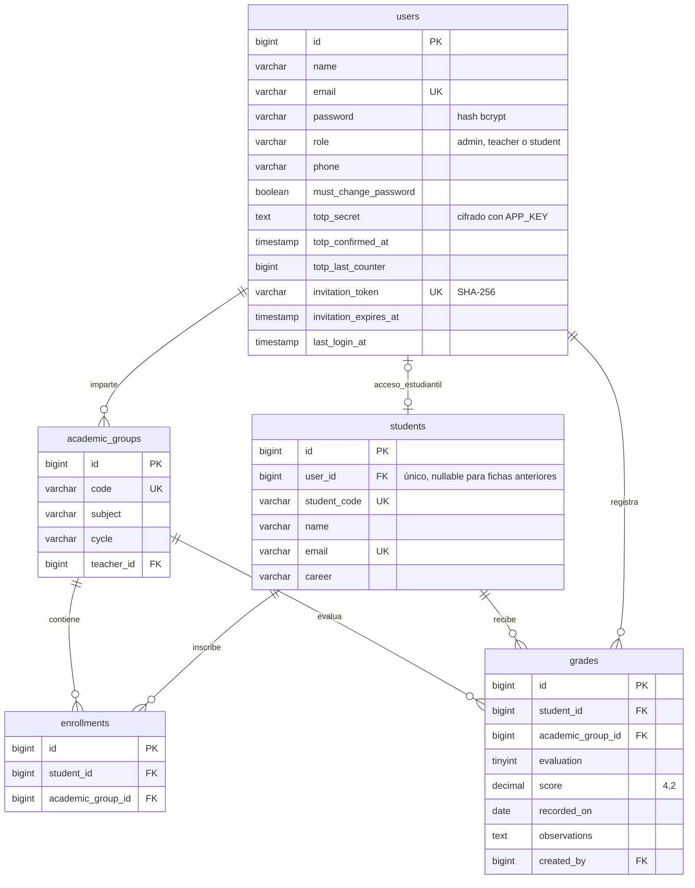

# Diagrama físico de la base de datos

SQLite para ejecución local; migraciones Eloquent compatibles con MySQL. Las tablas de soporte de Laravel son `sessions`, `password_reset_tokens`, `cache`, `cache_locks`, `jobs`, `job_batches` y `failed_jobs`.

Todas las tablas académicas, salvo `enrollments`, incluyen `created_at` y `updated_at`. La matrícula es única por estudiante y grupo. La nota es única por estudiante, grupo y evaluación. Las claves foráneas restringen eliminar docentes, estudiantes y grupos con historial. Solo las matrículas se eliminan en cascada.

La captura usa tres parciales por asignatura, con notas de 0 a 10. En esta práctica, el promedio es aritmético de las notas filtradas y la aprobación requiere al menos 6.00. No se aplica una ponderación institucional no especificada. El gráfico agrupa por estudiante, por lo que cada estudiante cuenta una sola vez en la consulta.

La tabla `Solicitud_de_constancias` de la referencia corresponde a otro trámite. Este proyecto implementa Consulta de Notas y usa un modelo relacional académico con inscripciones.
