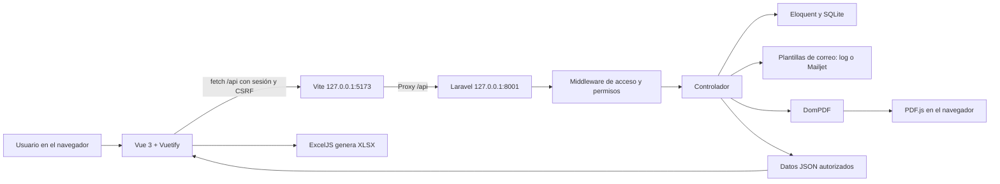
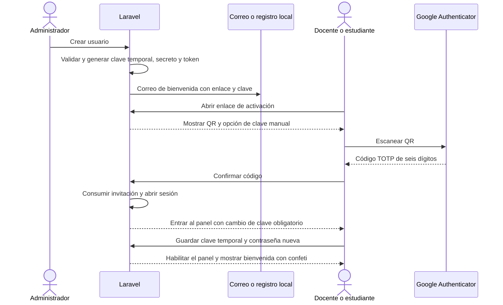

# Documentación del sistema Consulta de Notas ULS

## 1. Propósito y alcance

Consulta de Notas ULS es una aplicación de práctica para administrar información académica de la Universidad Luterana Salvadoreña. Centraliza docentes, estudiantes, grupos, matrículas y evaluaciones. Ofrece acceso por rol, activación con QR, correos de bienvenida, recuperación de acceso, informes PDF, exportación Excel y boleta de inscripción personal.

El sistema tiene tres actores: administrador, docente y estudiante. La carrera utilizada es **Licenciatura en ciencias de la computacion**. El trámite de constancias de una referencia inicial no forma parte de esta implementación.

## 2. Arquitectura y recorrido de una petición

El frontend y el backend se ejecutan como procesos separados en desarrollo. El navegador utiliza URLs `/api` del mismo origen visible; Vite las reenvía a Laravel. La autenticación utiliza la sesión de Laravel y una cookie HTTP-only, no un token JWT guardado en `localStorage`.

Para una escritura, `src/api.js` obtiene el token CSRF y envía `X-CSRF-TOKEN`. Laravel valida el acceso, aplica las reglas de negocio y consulta o modifica la base de datos. Devuelve JSON o un PDF según el endpoint. Los errores de validación se muestran en la interfaz.

## 3. Tecnologías: cómo y dónde se usan

| Tecnología | Función en el sistema | Ubicación principal |
|---|---|---|
| PHP 8.2+ / Laravel 12 | Backend, validación, sesiones, permisos, correo y endpoints. | `backend/app`, `backend/routes/academic.php`, `backend/bootstrap/app.php` |
| Eloquent | Relaciones y consultas: usuarios, estudiantes, grupos, matrículas y notas. | `backend/app/Models/` |
| SQLite | Persistencia local sin servicio adicional de base de datos. | `backend/database/database.sqlite`; estructura en `backend/database/migrations/` |
| Vue 3, Composition API | Estado reactivo, formularios y renderizado de vistas. | `src/views/`, `src/components/` |
| Vue Router | Navegación y guardas por sesión, rol y cambio inicial de contraseña. | `src/router.js` |
| Vuetify 3 | Inputs, diálogos, botones, alertas, selección de grupos y paginación. | `src/main.js`, `src/views/Records.vue` |
| Vite | Servidor del frontend, proxy de la API y compilación de producción. | `vite.config.js`, `package.json` |
| Fetch API | Comunicación HTTP y manejo común de errores y CSRF. | `src/api.js` |
| VueUse | QR reactivo, estado del menú y detección de pantalla móvil. | `useQRCode` en `AuthPage.vue`; `useLocalStorage` y `useMediaQuery` en `App.vue` |
| `qrcode` | Codifica la URI `otpauth://` como imagen QR local. | Integración de VueUse en `src/views/AuthPage.vue` |
| Google Authenticator / TOTP | Código temporal de seis dígitos para docentes y estudiantes. | `backend/app/Services/Totp.php`, `AuthController.php` |
| OTP Input de Vuetify | Seis casillas para introducir el código generado por la app. | `src/views/AuthPage.vue` |
| Lucide / AnimateIcons | Iconos de navegación, formularios y recursos animados. | `src/components/Icon.vue`, `src/views/Dashboard.vue` |
| Chart.js / vue-chartjs | Gráfico de estudiantes aprobados y reprobados del período. | `src/components/PerformanceChart.vue`, `src/views/Reports.vue` |
| DomPDF | Generación de cuadros de notas y boleta de inscripción en PDF. | `AcademicController.php`, `EnrollmentController.php`, `backend/resources/views/reports/` |
| PDF.js | Visor de PDF incrustado y navegación entre páginas. | `src/components/PdfViewer.vue` |
| ExcelJS | Generación de `.xlsx` con estilos, fechas, notas numéricas e impresión. | `src/services/gradeWorkbook.js`; carga diferida desde `Reports.vue` |
| Mailjet SMTP | Entrega real de invitaciones, avisos y notas, cuando se configura `smtp`. | `backend/config/mail.php`, `backend/.env`, `InvitationService.php` |
| Mailer `log` | Prueba de correos sin red: guarda el mensaje en el registro local. | `backend/storage/logs/laravel.log` |
| PHPUnit | Pruebas de permisos, autenticación, datos, recuperación y documentos. | `backend/tests/` |
| `node:test` | Comprueba el Excel generado reabriéndolo y revisando sus propiedades. | `tests/gradeWorkbook.test.mjs` |

Las versiones reproducibles se encuentran en `composer.lock` y `package-lock.json`. La paleta principal usa `#313945` y `#2D52A8`; los logos están en `public/` y `backend/public/images/`. El fondo del acceso es un SVG local generado por `scripts/generate-auth-background.mjs`.

## 4. Módulos y pantallas

| Módulo | Qué hace | Implementación |
|---|---|---|
| Acceso | Login, QR, OTP, recuperación de contraseña. | `src/views/AuthPage.vue`, `AuthController.php` |
| Panel | Notas recientes y grupos; para personal autorizado también muestra indicadores y gráfico. | `src/views/Dashboard.vue`, método `dashboard` |
| Gestión de notas | Registrar, actualizar, eliminar y enviar una nota por correo. | `src/views/Records.vue` con `kind=grades`, `GradeTable.vue`, `AcademicController.php` |
| Docentes | Crear, editar, eliminar según dependencias, reenviar correo y restablecer QR. | `Records.vue` con `kind=teachers` |
| Estudiantes | Ficha, carrera, grupos inscritos, cuenta y estado de activación. | `Records.vue` con `kind=students`; modelos `Student` y `User` |
| Grupos | Asignatura, código, ciclo, docente responsable y consulta de alumnos inscritos. | `Records.vue` con `kind=groups`, modelo `AcademicGroup` |
| Informes | Filtros, gráfico, cuadro de notas, PDF y Excel. | `src/views/Reports.vue` |
| Mi inscripción | Boleta personal con selección de ciclo, visor y descarga PDF. | `src/views/Enrollment.vue`, `EnrollmentController.php` |
| Mi perfil | Editar nombre y teléfono; consultar correo y rol; cambiar contraseña. | `src/views/Profile.vue`, métodos `profile` y `updateProfile` |
| Cambio inicial | Modal obligatorio dentro del panel antes de habilitar operaciones. | `src/components/PasswordDialog.vue`, `src/App.vue` |
| Bienvenida | Mensaje personalizado y confeti después del primer cambio correcto de clave. | `src/components/WelcomeCelebration.vue` |

Las listas usan cinco registros por página. El menú lateral se contrae a iconos o se expande; en móvil se abre como panel superpuesto. Las pantallas de acceso usan una tarjeta central y tamaños adaptables a la altura disponible.

## 5. Roles y permisos

| Operación | Administrador | Docente | Estudiante |
|---|---|---|---|
| Ingresar con correo y contraseña | Sí, sin OTP | Requiere además OTP | Requiere además OTP |
| Administrar docentes y estudiantes | Sí | No | No |
| Crear, editar o eliminar grupos | Sí | No | No |
| Ver grupos | Todos | Solo asignados | Solo inscritos |
| Registrar, editar o eliminar notas | Todos | Solo de sus grupos y alumnos inscritos | No |
| Enviar notas por correo | Sí | Solo de sus grupos | No |
| Informes, gráfico, Excel y CSV | Sí | Solo datos de sus grupos | No |
| PDF de notas | Sí | Solo datos de sus grupos | No |
| Boleta de inscripción PDF | No en el módulo personal | No | Solo su propia boleta |
| Mi perfil y cambio de contraseña | Propio | Propio | Propio |
| Reenviar invitación o restablecer QR | Sí | No | No |

Las restricciones se aplican en el backend, aunque alguien escriba una URL manualmente. `AcademicAccess.php` exige sesión, comprueba el cambio de clave y valida los permisos administrativos o del personal. Los controladores restringen las consultas por docente o estudiante. Las guardas del router y el menú complementan esa protección en la interfaz.

## 6. Flujos de acceso

### 6.1 Creación y primer acceso de docente o estudiante

El QR contiene una URI TOTP, no la contraseña del usuario. La invitación vence a las 72 horas y se utiliza una sola vez. La sesión se abre al confirmar el QR, pero las operaciones académicas permanecen bloqueadas hasta cambiar la contraseña temporal.

### 6.2 Inicio de sesión posterior

**Docente y estudiante:** correo + contraseña → desafío de cinco minutos → código de Google Authenticator → panel. El código dura 30 segundos, se admite una tolerancia de un intervalo y no se acepta un código ya utilizado. Hay límites de intentos en las rutas de autenticación.

**Administrador:** correo + contraseña → panel, sin pedir OTP. Esta es la política implementada para el rol. El administrador de evaluación tiene desactivado el cambio inicial de contraseña; las cuentas creadas normalmente pueden mantener esa obligación.

### 6.3 Cambio de contraseña y bienvenida

Se solicitan la contraseña actual o temporal, la nueva y su confirmación. La nueva debe ser diferente y contener al menos 12 caracteres, mayúsculas, minúsculas, números y símbolos. El backend guarda un hash y revoca las otras sesiones del usuario.

Cuando el cambio corresponde al primer acceso, aparece la bienvenida personalizada. No aparece si la validación falla ni en los cambios posteriores del perfil. La animación respeta la preferencia de movimiento reducido.

### 6.4 Recuperación de contraseña

En el login, **¿Olvidaste tu contraseña?** solicita el correo. Si existe la cuenta, se genera un enlace de recuperación de 30 minutos. La respuesta no confirma públicamente si el correo existe. El usuario cambia su contraseña; el autenticador permanece vinculado y seguirá siendo necesario para docentes y estudiantes.

### 6.5 Recuperación del autenticador por el administrador

En Docentes o Estudiantes, **Restablecer QR** solicita confirmación y muestra el correo destinatario. Se reemplazan el secreto TOTP, la clave temporal y el token de invitación. Se revocan las sesiones, los desafíos de login anteriores y los enlaces previos de recuperación. El correo de restablecimiento conduce a un QR nuevo. El usuario confirma el código y cambia la clave en el panel.

**Reenviar correo** es otra acción: una cuenta pendiente recibe una invitación renovada; una cuenta activa recibe el enlace de ingreso y conserva su autenticador y contraseña. Si falla el envío de una creación o restablecimiento, la transacción revierte los cambios.

## 7. Flujo académico y reglas de negocio

1. El administrador crea el docente y el grupo, indicando asignatura, código y ciclo.
2. Crea o edita al estudiante y selecciona sus grupos. Eso registra la matrícula en `enrollments`.
3. El docente inicia sesión y el sistema muestra únicamente sus grupos. El administrador puede trabajar con todos.
4. Para registrar una nota se seleccionan grupo, estudiante inscrito, parcial, fecha y nota.
5. La validación comprueba que la nota esté entre **0 y 10**, el parcial entre **1 y 3**, la fecha no sea futura y el estudiante pertenezca al grupo.
6. No puede existir más de una nota para el mismo estudiante, grupo y parcial.
7. El usuario autorizado puede editar, eliminar o enviar esa evaluación al correo del estudiante.

No se permite eliminar un estudiante o grupo con notas asociadas. Tampoco se pueden quitar matrículas que ya tengan notas. Los docentes con grupos o historial relacionado tienen restricciones de eliminación. Los errores explican la dependencia en lugar de borrar el historial.

La aprobación se determina con **6.00 o más**. Los indicadores usan el promedio aritmético de las notas filtradas. En el gráfico, cada estudiante se cuenta una vez y se clasifica según su promedio en la consulta. No se implementa una ponderación institucional de parciales no especificada ni se incluyen alumnos sin notas en ese gráfico.

## 8. Informes y documentos

### PDF de notas

`AcademicController::pdf` utiliza DomPDF y `backend/resources/views/reports/grades.blade.php`. Incluye logo, autor, período, resumen y evaluaciones autorizadas. El navegador lo abre en `PdfViewer.vue` mediante PDF.js y permite descargarlo.

### Excel de notas

`GET /api/reports/excel` devuelve los datos y metadatos autorizados según mes, grupo y parcial. `src/services/gradeWorkbook.js` crea el `.xlsx` en el navegador con ExcelJS. Tiene encabezado institucional, totales verdes, tabla azul clara, bordes, anchos definidos y ajuste de texto. Las notas son números y las fechas son celdas de fecha de Excel.

Se configura impresión **A4 horizontal**, una página de ancho, alto variable, repetición del encabezado de la tabla y numeración al pie. El texto se asigna como texto y no como fórmulas. ExcelJS se descarga en el navegador al utilizar la exportación, sin requerir extensiones adicionales de PHP para crear el archivo.

La API de CSV anterior se conserva para compatibilidad, con BOM UTF-8 y protección de fórmulas. La interfaz principal utiliza Excel.

### Boleta de inscripción

`EnrollmentController` obtiene al estudiante desde la sesión; no acepta identificadores de otros usuarios. La boleta contiene logo, carné, nombre, correo, carrera, ciclo, asignaturas, grupos, docentes y fecha de emisión. Permite seleccionar entre sus ciclos registrados.

El PDF está siempre incrustado en **Mi inscripción**, con descarga disponible. Si no tiene matrículas, se muestra un aviso; no se genera una boleta vacía. Este documento personal no habilita al estudiante para consultar los informes generales.

## 9. Base de datos

El [diagrama físico](base-de-datos.md) describe los campos y relaciones. Las entidades académicas son:

| Tabla | Responsabilidad |
|---|---|
| `users` | Identidad, rol, hash de contraseña, secreto TOTP cifrado, activación y obligación de cambiar clave. |
| `students` | Ficha académica, carné único, carrera y vínculo opcional con la cuenta de acceso. |
| `academic_groups` | Código único, asignatura, ciclo y docente responsable. |
| `enrollments` | Matrícula única por estudiante y grupo. |
| `grades` | Nota única por estudiante, grupo y parcial; fecha, observaciones y autor. |

Laravel también administra sesiones, tokens de recuperación, caché y tablas de trabajos. En esta aplicación el envío de correo se realiza durante la petición; no hace falta iniciar un trabajador de colas para el recorrido de prueba.

Los estudiantes de la semilla inicial son fichas de demostración y pueden no tener `user_id`. Al reenviar una invitación o restablecer el QR se crea el acceso cuando falta, conservando la ficha y sus matrículas.

## 10. Rutas principales

Todas las rutas de esta tabla se encuentran bajo `/api` en `backend/routes/academic.php`. Se utilizan sesiones y, para escrituras, CSRF.

| Rutas | Uso y acceso |
|---|---|
| `GET /auth/csrf`, `POST /auth/login`, `POST /auth/verify` | Preparar sesión y autenticar; límites de intentos. |
| `GET /auth/me`, `POST /auth/logout` | Consultar usuario actual y cerrar sesión. |
| `GET /auth/invitations/{token}`, `POST .../confirm` | Obtener QR y confirmar invitación válida. |
| `POST /auth/forgot-password`, `POST /auth/reset-password` | Recuperación de contraseña. |
| `PUT /auth/password` | Cambiar contraseña propia; disponible durante el primer acceso. |
| `GET/PUT /profile` | Consultar o actualizar el perfil propio. |
| `GET /dashboard`, `GET /options` | Panel y catálogos filtrados por rol. |
| `GET/POST /grades`, `PUT/DELETE /grades/{grade}` | Consultar o gestionar notas según permisos. |
| `POST /grades/{grade}/email` | Enviar una nota autorizada. |
| `/teachers`, `/students`, `/groups` | Directorios y operaciones académicas; las escrituras administrativas requieren administrador. |
| `POST /teachers/{teacher}/invite`, `/students/{student}/invite` | Reenviar correo de acceso o invitación. |
| `POST /teachers/{teacher}/reset-access`, `/students/{student}/reset-access` | Restablecer QR y acceso; solo administrador. |
| `GET /reports`, `/reports/pdf`, `/reports/excel`, `/reports/csv` | Informes para administrador o docente, con datos autorizados. |
| `GET /enrollment`, `/enrollment/pdf` | Inscripción personal del estudiante. |
| `GET /system/mail-status` | Diagnóstico SMTP del proceso web, solo administrador; no envía mensajes. |

## 11. Seguridad y configuración

- Contraseñas guardadas con hash mediante el modelo `User`.
- Secretos TOTP cifrados con `APP_KEY` y ocultos en las respuestas generales del usuario.
- Tokens de invitación guardados como SHA-256, con vencimiento y consumo único.
- Sesión regenerada al ingresar; cierre de sesión con invalidación del servidor.
- Cookie HTTP-only y protección CSRF para escrituras.
- Validación del rol en Laravel y filtrado de pertenencia en las consultas.
- Firma del desafío OTP ligada a las credenciales actuales: un restablecimiento invalida los intentos anteriores.
- Transacciones en creación de cuentas, matrículas y recuperación para conservar consistencia.
- Credenciales SMTP en `.env`, fuera del frontend y del control de versiones.

La cuenta pública de evaluación se crea solo con `APP_ENV=local` o durante pruebas. No se debe usar esa base de demostración como base de producción.

## 12. Pruebas, instalación y mantenimiento

El [README](../README.md) explica cómo instalar y ejecutar. La [guía del docente](guia-pruebas-docente.md) propone el recorrido manual. `php artisan test` usa SQLite en memoria y correo simulado; `node --test tests/gradeWorkbook.test.mjs` revisa el Excel; `npm run build` valida la compilación del frontend.

Para modificar la aplicación: cambiar una vista en `src/views`, un componente compartido en `src/components`, reglas o consultas en los controladores y servicios de Laravel, y estructura de datos mediante una migración. Después, ejecutar las verificaciones relacionadas. No modificar `dist` directamente, porque se vuelve a generar en cada compilación.

Para crear administradores reales existe `php artisan uls:admin correo@ejemplo.com --name="Nombre"`; envía la bienvenida con su clave temporal por el mailer configurado. Para la evaluación sin correo se utiliza `php artisan uls:demo-admin`. Los comandos completos y la configuración de Mailjet están documentados en el README.
